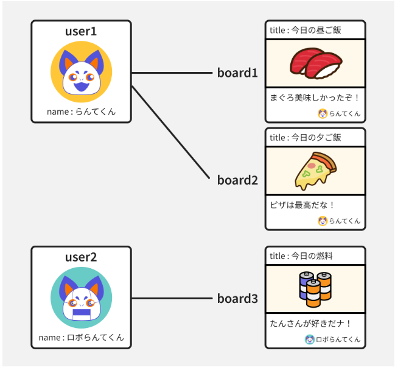

リレーション

【リレーションとは】  
リレーションとはデータベース内の異なるデータ同士がどのように関連しているかを示すもの。  
関係には「1対1」、「1対多」、「多対多」などがある  
※似たものでアソシエーションという概念があるが、  
これはモデル同士の関係を表したもの。  
リレーションはDBの関係を表す。  

【1対1】  
1つのテーブルのレコードは別のテーブルの1つのレコードとだけ関連付けられている。  
例)ユーザーテーブルとプロフィールテーブル  
1人のユーザーは1つのプロフィールとだけ紐づけられている。  

【1対多】  
1つのテーブルのレコードが別のテーブルの複数レコードと紐づいている。  
例)ユーザーテーブルと掲示板テーブル  
1人のユーザーは複数の掲示投稿を行える。  
user1に対して投稿2件など  
  
